<div align="center">

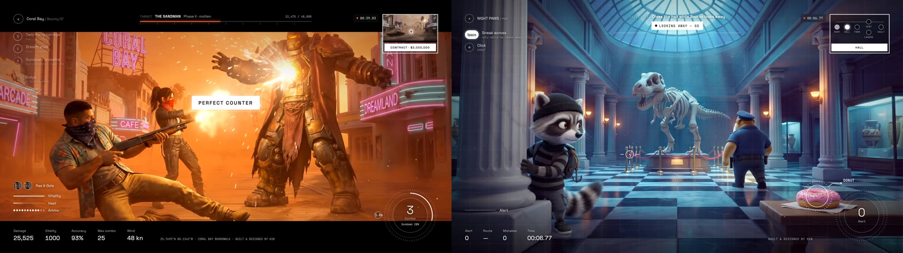

# Video Game Forge

**Turn AI-generated images and video into playable games.**
A provider-agnostic Claude skill, plus a data-driven engine that makes generated footage interactive.

[](CHANGELOG.md)
[](LICENSE)
[](SKILL.md)
[](engine/)
[](https://foundation-k28.vercel.app)

[Play the demos](https://foundation-k28.vercel.app) · [How it works](#how-it-works) · [Quickstart](#quickstart) · [game.json](references/game-json.md) · [Author](#author)

</div>

---

AI video models can render worlds that would take a game studio months. But a clip is something you watch, not something you play. **Video Game Forge closes that gap.** Every game state becomes one generated clip: an idle loop, an action, a reaction, a cutscene, an ending. A small engine cuts between clips on player input and draws the live gameplay layer on top: timing windows, reaction rings, clickable hotspots, choices, targets, meters, HUD and sound.

It's part of **[Foundation by K28](https://foundation-k28.vercel.app)**, a research initiative on turning AI-generated video and image assets into interactive, high-quality experiences: micro-games, simulations, and learning and development scenarios.

## Demo samples

Both games were built end to end with this skill and run on the **same, unmodified engine**. Only their `game.json` differs.

<table>
<tr>
<td width="50%" valign="top">

### DUSTFALL: Coral Bay
Boss fight · cinematic photoreal · 16 clips

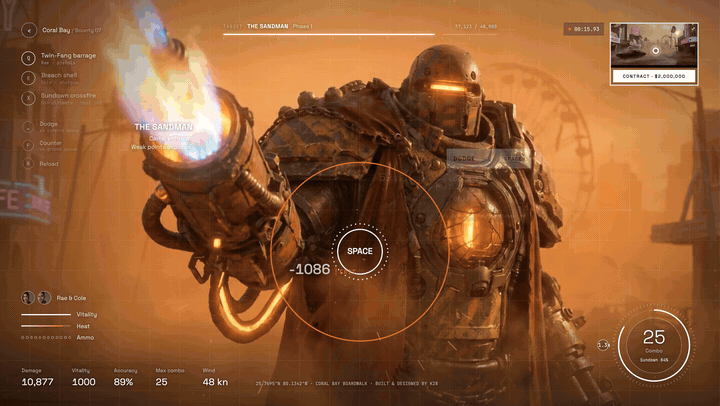

- Shoot weak points as they open, with hit and crit damage numbers.
- Cooldown abilities, and a duo ultimate powered by heat.
- Random boss attacks: dodge or counter as the ring closes.
- A phase-2 transformation, then a visor finisher.

[▶ 20 s teaser](docs/media/dustfall-teaser-1080p.mp4) · [4K gameplay (Releases)](../../releases/tag/v1.0.0) · [`dustfall.game.json`](examples/dustfall.game.json)

</td>
<td width="50%" valign="top">

### NIGHT PAWS: The Moonstone Caper
Stealth heist · stylized 3D · 17 clips

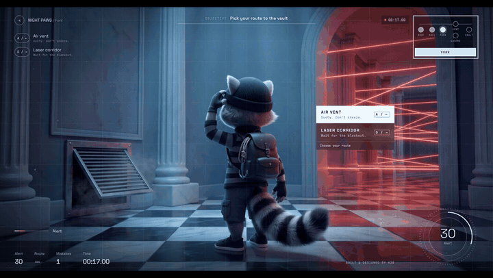

- Move only inside timing windows: while the guard looks away, or while the lasers are off.
- A route choice, a sneeze to hold in, and a grapple escape.
- An inventory hotspot that changes the ending, an alert meter, and three endings.

[▶ 30 s teaser](docs/media/nightpaws-teaser-1080p.mp4) · [4K gameplay (Releases)](../../releases/tag/v1.0.0) · [`nightpaws.game.json`](examples/nightpaws.game.json)

</td>
</tr>
</table>

<details>
<summary><b>More screens</b></summary>
<br>

| | |
|---|---|
| 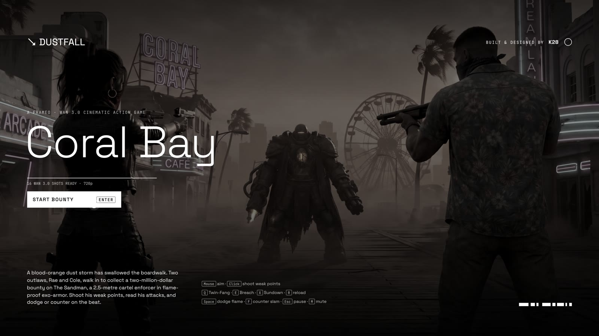 | 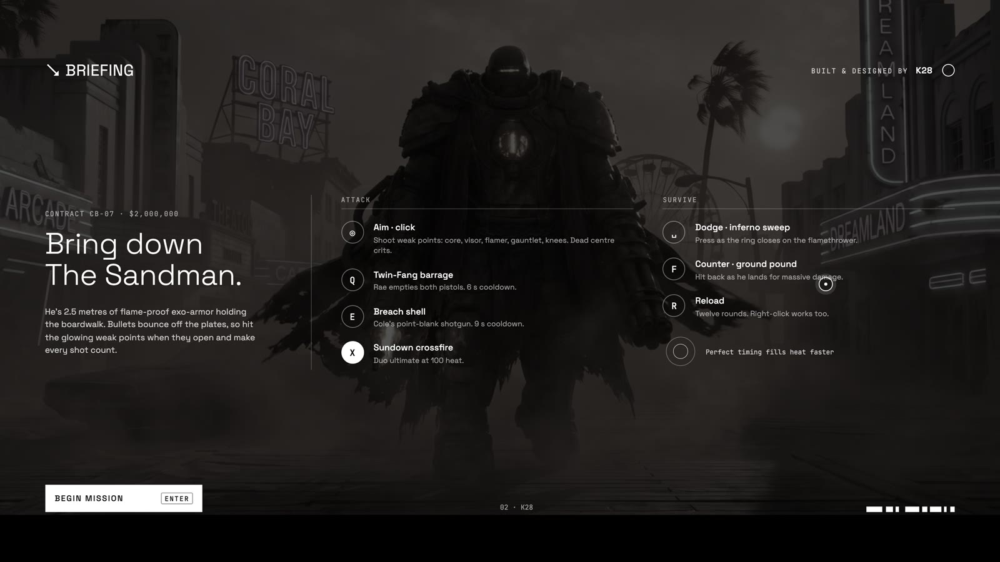 |
| 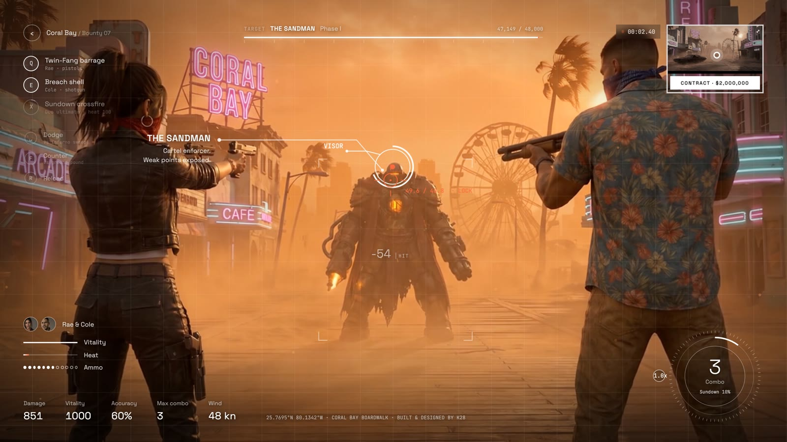 | 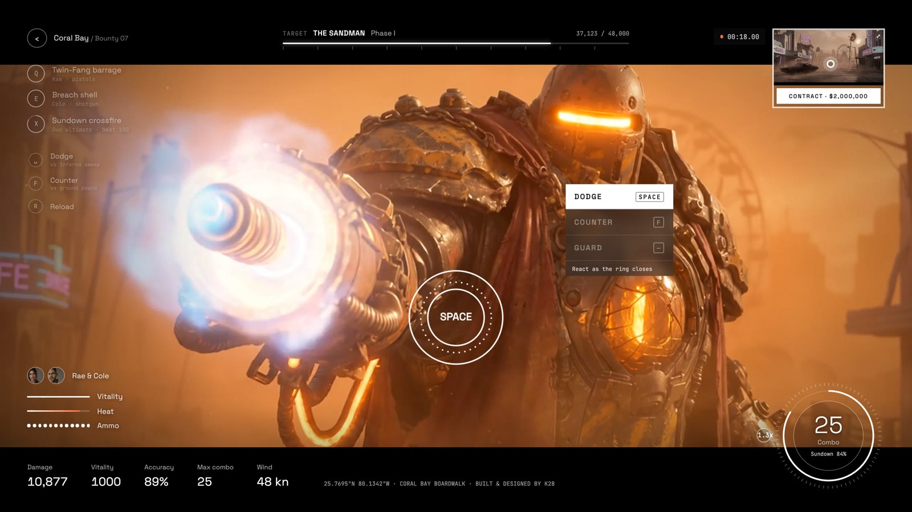 |
| 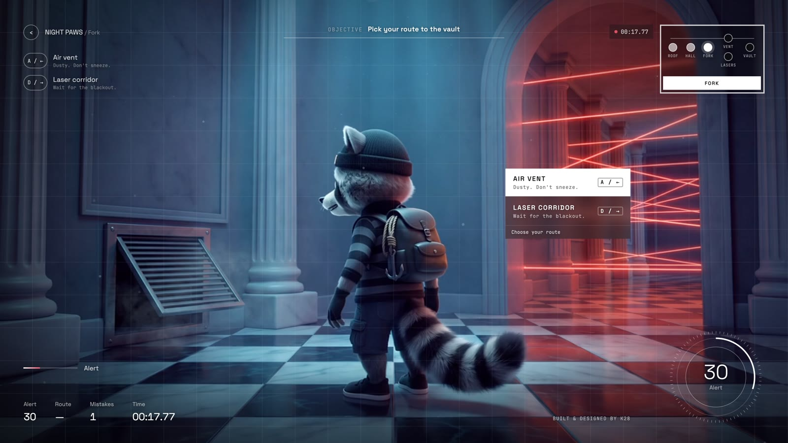 | 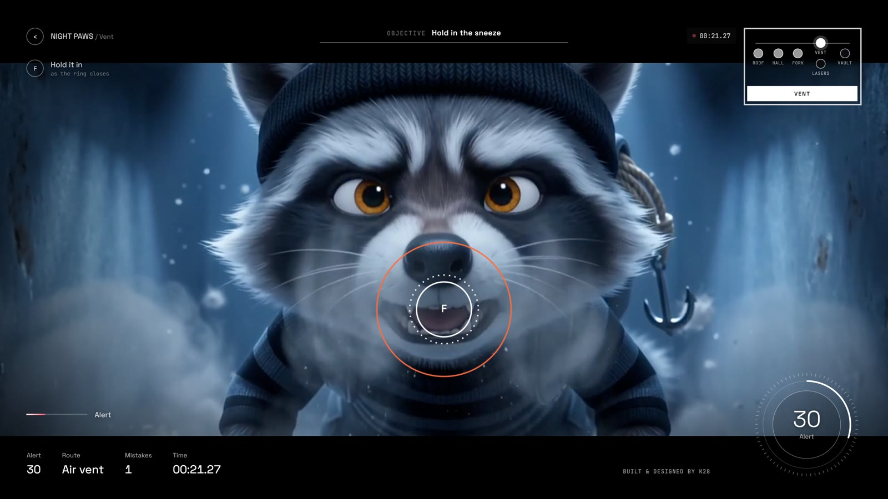 |
| 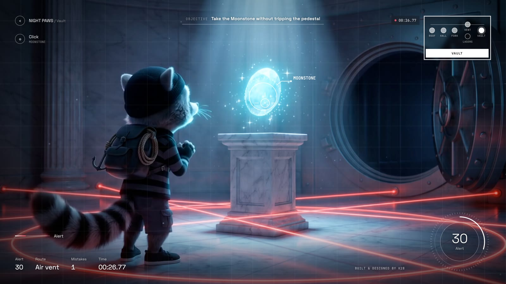 | 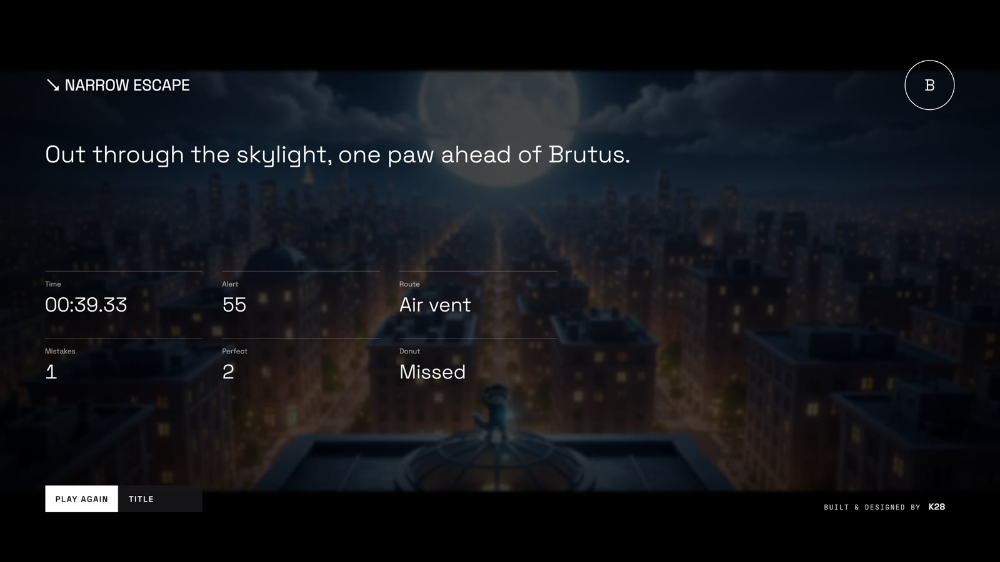 |

</details>

## How it works

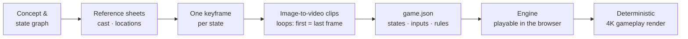

1. **Pick providers.** The skill finds the image and video tools in your session (any MCP server or API key), recommends some, and **you choose**. It quotes costs before generating anything.
2. **Design.** A core loop, a state graph and a shot list. Every mechanic is something video can express: a guard turning, lasers blinking, a boss winding up.
3. **Consistency first.** Character and location sheets, then one keyframe per state built from those sheets, then image-to-video. Idle states use the same image as first and last frame, so they loop seamlessly.
4. **Assemble.** Encode the clips, measure timing windows from the pixels (`analyze.mjs curve`), and write `game.json`.
5. **Playtest.** Script every branch in the browser, then let the seeded autopilot play the whole game.
6. **Showcase.** Optionally render a frame-by-frame gameplay video (not a screen recording) with the clips' own audio mixed under the engine score.

<p align="center">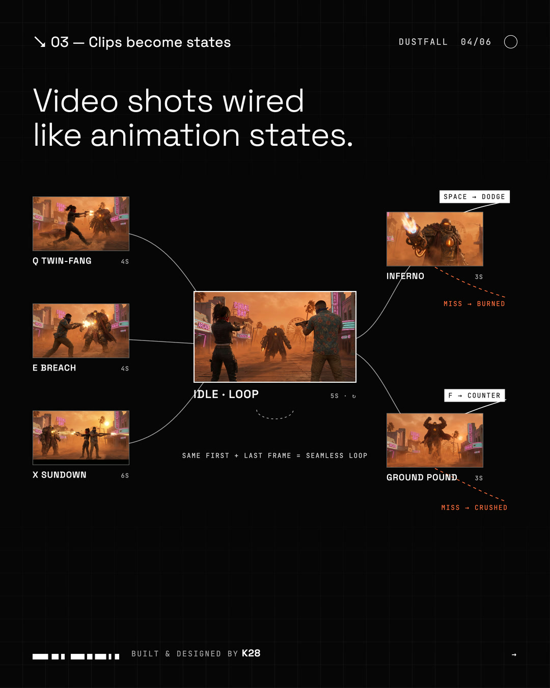</p>

## Engine at a glance

| Mechanic | What the player feels | `game.json` |
|---|---|---|
| Timing windows in loops | "Go now!": stealth, rhythm | `inputs[].windows` + live safe/danger pill |
| Reaction rings | Dodge, parry, hold a sneeze | `qte` (perfect / good / fail, optional continue) |
| Hotspots | Point-and-click, items, targets | `hotspots[]` with conditions |
| Choices | Branching routes and dialogue | `choices[]` |
| Spawning targets | Shooting gallery, weak points | `spawn` with hit / crit |
| Abilities | Special moves with cooldowns | `inputs[].cooldown` |
| World timers | Enemy attacks, patrols, countdowns | `timers[]` + `random` |
| Meters, rules, endings | HP, alert, mood, ranks | `vars`, `rules`, `endings`, `rank` |

Also included:
- **HUD**: hairline, objective line, room map, dial, readouts.
- **Synth score**: four moods.
- **Cinematic letterboxing**.
- **Touch controls**.
- **Render mode**: a virtual clock with a seeded autopilot.

## Quickstart

**As a Claude skill**

```bash
git clone https://github.com/Kayariyan28/video-game-forge ~/.claude/skills/video-game-forge
```

Then ask Claude something like:
- *"Make a playable stealth game from AI video."*
- *"Prototype this game concept with video models."*

It will ask which image and video provider to use and walk you through each phase.

**By hand**

```bash
scripts/new-game.sh ~/games/my-game                 # engine + starter game.json + asset folders
# …put generated clips in assets/source/, then:
scripts/prep-clips.sh ~/games/my-game/assets/source ~/games/my-game/assets/video
node scripts/analyze.mjs seam  ~/games/my-game/assets/source      # are the loops clean?
node scripts/analyze.mjs curve ~/games/my-game/assets/source/loop.mp4 --roi 0.4,0.2,0.4,0.4 --channel luma
cd ~/games/my-game && python3 -m http.server 8080   # play at http://localhost:8080
```

**Render a gameplay video** (needs Google Chrome):

```bash
cd scripts && npm i
node render.mjs --url http://localhost:8080/ --scale 3 --out ../exports/my-game-4k   # 3 = 4K, 2 = 1440p
node mix.mjs --game ~/games/my-game --out ../exports/my-game-4k
```

## Bring your own models

Nothing is tied to one vendor. The skill needs:

| Capability | Used for |
|---|---|
| Image generation with **reference images** | Consistent cast sheets and per-state keyframes |
| **Image-to-video** (first frame) | Every clip starts from its approved keyframe |
| **Last-frame** input *(recommended)* | Seamless idle loops; [fallbacks](references/providers.md#loop-fallbacks-no-last-frame-input) if missing |
| Generated audio *(optional)* | Footsteps, impacts, character lines |

It works with aggregator MCP servers and direct APIs. See [`references/providers.md`](references/providers.md) for detection, the adapter contract and known providers. Both demos were made for about **1,370 credits each** on the provider used: around 16 clips at 720p with sound, plus sheets and keyframes.

## Repository

```
SKILL.md                 the workflow Claude follows
engine/                  runtime template: index.html, engine.css, engine.js, render/hooks.js
scripts/                 new-game.sh · prep-clips.sh · analyze.mjs · render.mjs · mix.mjs
references/              providers · design-patterns · asset-prompting · game-json · tuning-and-testing · showcase
examples/                dustfall.game.json · nightpaws.game.json · starter.game.json
docs/media/              demo screenshots, previews and teasers
```

Requirements: Node 18+, ffmpeg/ffprobe and Python 3. Rendering also needs Google Chrome.

## Roadmap
- More genre templates: goalkeeper reflex, point-and-click mystery, cozy pet, lane runner.
- Branching dialogue with generated voice, and saving progress.
- Learning and development simulation templates (scenario → decision → consequence), with scoring exports.
- Provider adapters as ready-made scripts for common APIs.

## Author

**Karan Chandra Dey [K28]**
Creator and sole maintainer · [k28art.space](https://k28art.space) · [@Kayariyan28](https://github.com/Kayariyan28)

Built and designed by K28 as part of **Foundation by K28**.

## License

Code is under the [MIT License](LICENSE). The demo media in `docs/media` (renders and characters of the example games) is © Karan Chandra Dey [K28]; see LICENSE.
