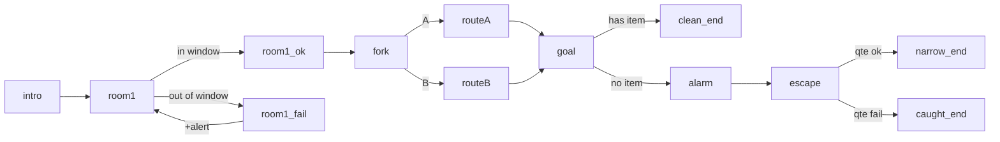

# Design patterns: making video playable

A video model can't respond to input in real time, so **interactivity comes from cutting between pre-rendered states**, plus a live layer drawn on top. Design every mechanic as: *which clip is playing* + *what the player can do during it* + *which clip comes next*.

## Mechanics catalogue (each maps to game.json)
| Mechanic | Feels like | Clips needed | game.json |
|---|---|---|---|
| **Timing window in a loop** | Stealth, rhythm, "go now!" | 1 seamless loop where the safe moment is visible, plus success and fail clips | `inputs[].windows` + `safe`/`danger` labels (live HUD pill) |
| **Reaction ring (QTE)** | Dodge, parry, catch, hold a sneeze | 1 wind-up clip that builds to a beat, plus success and fail clips (or one clip that continues on success) | `qte` with `at`, `perfect`, `good`, `ok`, `fail`, `continue` |
| **Hotspots** | Point-and-click, pick up items, choose a target | Any clip where the object is visible and stays put (idle loops are ideal) | `hotspots[]` with `x`, `y`, `r`, `if`, `do` |
| **Choices** | Branching routes, dialogue answers | 1 short loop to decide over, plus one clip per branch | `choices[]` (menu with keys) |
| **Spawning targets** | Shooting gallery, whack-a-mole, weak points | 1 idle loop of the target area | `spawn` with `points`, `every`, `life`, `hit`/`crit` |
| **Abilities with cooldowns** | Special moves | 1 action clip per ability that returns to idle | `inputs[]` with `cooldown`, `ok: "ability_state"` |
| **Meters + rules** | HP, alert, mood, score | none | `vars`, `hud.meters`, `hud.dial`, `rules` |
| **Enemy/world timers** | Boss attacks, patrol events, countdowns | the telegraph clips | `timers[]` with random `after`/`every` + `random` action |
| **Endings + rank** | Replay value | 1 clip per ending | `endings`, `rank`, `results` |

## Pacing rules that worked
- **1–3 minutes per run, a decision every 3–6 seconds.** Idle loops are where the player acts; keep them 4–6 s so the safe window comes round quickly.
- **Failure continues the game.** A failure plays a funny or dramatic "fail" clip, raises a meter, and returns to the loop. Only a meter rule ends the game.
- **Telegraph everything.** The clip itself must show the cue: the guard turning, the lasers flickering, the boss winding up. The HUD (live pill, closing ring) confirms it.
- **At least two routes or two endings**, plus a rank, so the second run is different.
- **Cutscenes are rewards.** Keep them short (≤ 8 s), skippable intro, letterboxed (`bars`).
- **One clip = one idea.** Don't ask a 4 s clip to show three beats.

## Genre recipes (clip budgets)
**Boss fight (14–16 clips).** Example: `examples/dustfall.game.json`.
- Clips: intro, reveal, idle loop, 2–3 ability clips (each returns to idle), 2 attack wind-ups, each with a success and a hit outcome, special, phase-2 transformation, finisher, win, lose.
- Mechanics: spawn targets on the boss, abilities with cooldowns, random attack timer → QTE, rules for phase 2 and the finish.

**Stealth heist (15–17 clips).** Example: `examples/nightpaws.game.json`.
- Clips: intro, room loops with visible patrol or laser windows, sneak and spotted clips per room, a fork loop, two route rooms, a vault loop with an item hotspot, alarm, escape, two endings.
- Mechanics: windows, choices, inventory var + conditional hotspot, alert meter rule.

**Goalkeeper / reflex arcade (10–12 clips).**
- Clips: run-up wind-ups (2–3 variants), save-left / save-centre / save-right, conceded-left / centre / right, win, lose.
- Mechanics: `random` picks a run-up, which sets `shot` = left|centre|right. Inputs check `shot` with `if` to choose the save or conceded clip. A score var and 5 rounds drive the ending.

**Point-and-click mystery (12–16 clips).**
- Clips: room loops with clue hotspots, close-up clue reveals, suspect interview loops with choices, the accusation, right and wrong endings.
- Mechanics: hotspots set clue vars, and choices unlock with `if`.

**Cozy pet / tamagotchi (10–12 clips).**
- Clips: idle loops per mood (happy, hungry, sleepy), feed, play and sleep actions, an evolution cutscene.
- Mechanics: random timers lower meters, choices act on them, and rules switch the idle state by mood (`if` in `next`).

**Runner / lane dodge (8–10 clips).**
- Clips: a run loop per lane, dodge-left and dodge-right transitions, hit, finish.
- Mechanics: random obstacle timers → QTE or windowed input; distance var.
- Keep it short; video can't scroll procedurally.

## State graph template

